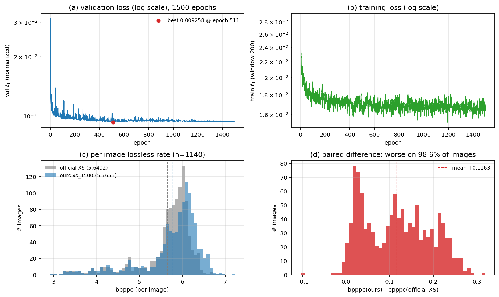
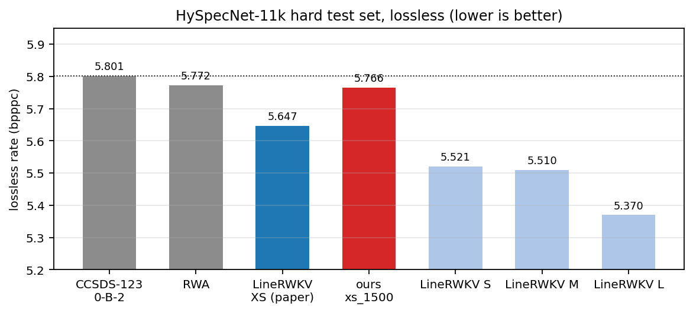

# LineRWKV 复现记录 · HySpecNet-11k 高光谱无损压缩

复现论文：D. Valsesia, T. Bianchi, E. Magli, *Onboard Deep Lossless and Near-Lossless
Predictive Coding of Hyperspectral Images With Line-Based Attention*, IEEE TGRS,
vol. 62, 2024（DOI 10.1109/TGRS.2024.3465043，[arXiv:2403.17677](https://arxiv.org/abs/2403.17677)）。
官方代码：[diegovalsesia/linerwkv](https://github.com/diegovalsesia/linerwkv)。

本仓库记录我**从零训练 + 完整测试集评估**的复现过程、与论文的差距、以及对差距的归因分析。

> **一句话结论**：在 HySpecNet-11k hard test（1140 张）无损档上，我自己训练的
> LineRWKV-XS 取得 **5.7655 bpppc**，比论文报告的 5.647 差 **0.118 bpppc（+2.1%）**，
> 但仍优于 CCSDS-123.0-B-2（5.801）与 RWA（5.772）。差距是**系统性**的（98.6% 的图像
> 都变差），最可能的原因是我只完成了论文两阶段训练流程的**第一阶段**（缺全波段微调）。
> 详细归因见第 3 节。





---

## 目录

- [1. 我做了什么](#1-我做了什么)
- [2. 结果](#2-结果)
- [3. 差距归因：为什么差 0.118 bpppc](#3-差距归因为什么差-0118-bpppc)
- [4. 这次复现给我的几点思考](#4-这次复现给我的几点思考)
- [5. 关于研究生小论文创新点构思的经验](#5-关于研究生小论文创新点构思的经验)
- [6. 仓库结构与复现命令](#6-仓库结构与复现命令)
- [7. 环境与时间线](#7-环境与时间线)

---

## 1. 我做了什么

### 1.1 复现对象

LineRWKV 是一个**预测式**（而非自编码器式）高光谱压缩网络：
先用 1-D 卷积沿**列**方向编码，再用两套 RWKV 依次在**行**方向和**波段**方向做因果预测，
最后只把预测残差交给 CCSDS-123.0-B-2 的 sample-adaptive Golomb 编码器。
它最大的卖点是显存只与「一行」有关，可以推扫式连续运行。

### 1.2 数据集

HySpecNet-11k 的 **hard split**（EnMAP 卫星，128×128×224 的 patch，
去掉 22 个坏波段后剩 202 个波段），train 8044 / test **1140** 张。
预处理按论文：裁剪到 `[0, 10000]`。

### 1.3 训练配置：刻意对齐官方 XS

| 超参数 | 官方 XS（仓库 `log_dir/linerwkv/xs/config.txt`） | 我的 xs_1500 | 是否一致 |
|---|---|---|---|
| `dim_enc` / `dim_att` / `dim_ffn` | 32 / 32 / 32 | 32 / 32 / 32 | ✅ |
| `N_layers_encoder` | 1 | 1 | ✅ |
| `n_layer_lines` / `n_layer_bands` | 2 / 2 | 2 / 2 | ✅ |
| `N_layers_decoder` | 1 | 1 | ✅ |
| `batch_size` / `pos_size` | 3 / 128 | 3 / 128 | ✅ |
| `lr_init` → `lr_final` | 5e-4 → 1e-6 | 5e-4 → 1e-6 | ✅ |
| `epoch_count` | 8000 | **1500** | ❌ |
| 数据裁剪 | **未裁剪**（代码里被注释掉） | **裁剪到 [0, 10000]** | ❌ |
| 训练波段 | 每条样本随机 16 个连续波段 | 同左 | ✅ |
| 第二阶段全波段微调 | 有（论文 Sec. IV-A） | **没做** | ❌ |

模型规模 30.5 K 参数（0.122 MB）：`encoder` 192、`decoder` 33、`bandzerodec` 33、
`blocks_lines` 15.1 K、`blocks_bands` 15.1 K。

### 1.4 训练与评估

```
训练：单卡 RTX 3090（CUDA_VISIBLE_DEVICES=4），1500 epoch
      2026-10-04 22:49 → 2026-10-09 04:45，累计 101.9 小时（4.2 天）
评估：同一张卡，HySpecNet-11k hard/test 全部 1140 张，delta=0（无损）
      2026-10-09 15:05 → 19:27，约 11 秒/张，共 4 小时 21 分
```

评估前我做了两件事，这两件事后来证明比训练本身更重要：

1. **用官方预训练权重先跑一遍**——得到 5.6492 bpppc，与论文的 5.647 几乎完全一致。
   这证明「尺子是准的」，之后我的模型的任何偏差都只能是模型本身的问题。
2. **压缩→解压往返校验**：`ROUND-TRIP LOSSLESS: PASS`，330 万像素逐比特一致。
   确认这套无损管线是自洽的，不会出现「压缩码率好看但解不回来」的假结果。

---

## 2. 结果

### 2.1 训练曲线

| 指标 | 值 |
|---|---|
| val ℓ1 首值 | 0.025250 |
| val ℓ1 末值 | 0.009364 |
| val ℓ1 最优 | **0.009258 @ epoch 511** |
| val ℓ1 最后 100 epoch 均值 | 0.009357 |
| train ℓ1 首/末 | 0.149259 / 0.000716 |

训练在 epoch 500 左右就已经进入平台期（见总览图 (a)(b)），后 1000 个 epoch 几乎没有
带来可见收益。

### 2.2 测试集结果（lossless，1140 张）

| 项目 | 值 |
|---|---|
| 平均 bpppc | **5.7655** |
| 最小 / 最大 bpppc | 2.9210 / 7.2180 |
| 总码流 | 2,719,103,503 字节（2.72 GB） |
| 失败图像数 | 0 |

### 2.3 与论文的差距

| 方法（HySpecNet-11k hard test，无损） | bpppc | 与我的差值 |
|---|---|---|
| 论文 Table II — LineRWKV-**S** | 5.521 | −0.245 |
| 论文 Table II — LineRWKV-**M** | 5.510 | −0.256 |
| 论文 Table II — LineRWKV-**L** | 5.370 | −0.396 |
| **论文 Table II — LineRWKV-XS** | **5.647** | **+0.118（我差 2.1%）** |
| 官方预训练 XS（我用同一脚本实跑） | 5.6492 | +0.116 |
| 论文 Table II — RWA | 5.772 | −0.007 |
| 论文 Table II — CCSDS-123.0-B-2 | 5.801 | −0.036 |
| **我的 xs_1500** | **5.7655** | — |

### 2.4 逐图配对比较（我的模型 vs 官方 XS，n = 1140）

只比平均值是不够的，所以我把两张图的结果做了**逐图配对**：

| 指标 | 值 |
|---|---|
| 平均配对差 | +0.1163 bpppc |
| 中位配对差 | +0.1153 bpppc |
| 配对差标准差 | 0.0762 |
| 变差的图像 | **1124 张（98.6%）** |
| 变好的图像 | 16 张（1.4%） |
| 总码流差 | +54.9 MB |

这个分布形状（见总览图 (c)(d)）说明差距不是被少数难图拖累，而是**整体右移**。

---

## 3. 差距归因：为什么差 0.118 bpppc

### 3.1 先排除「尺子不准」

同一套脚本、同一批图，官方预训练 XS 跑出 5.6492，论文是 5.647，相对误差 0.04%。
所以评估管线、数据预处理、码率统计口径都是可信的，差距是模型能力差异。

### 3.2 差距是系统性的

98.6% 的图像变差、配对差标准差只有 0.076（均值 0.116），说明是**分布平移**而非个例。
这种形状通常指向「训练分布与推理分布存在系统性失配」，而不是过拟合或数据错误。

### 3.3 第一嫌疑：训练与推理的波段数不一致

这是我认为最可能的原因，逻辑链如下：

1. `dataset.py` 在训练模式下每条样本**只随机取 16 个连续波段**
   （论文 Sec. IV-A 也承认这是「初期训练阶段」的做法）；
2. 推理时输入是完整的 **202 个波段**；
3. 谱预测器是一条沿波段方向的 RWKV 递归链，可训练参数里包含
   `time_decay`（衰减率）和 `time_mix`（历史混合比例）；
4. **这些参数只在 16 步的序列上被优化过**，却被要求外推到 202 步。
   我训练的模型在长序列上既没有学到正确的衰减尺度，也没有见过第 16 步之后的输入分布。

论文的做法正好补上这一环：

> “a random subset of 16 contiguous bands has been used in the initial training phases,
> **followed by fine-tuning with all the available bands and a smaller batch size**.”
> —— Sec. IV-A

而我这次只做了前半段。

### 3.4 第二嫌疑：训练轮数（我认为影响较小）

1500 epoch vs 官方 8000 epoch。但从 2.1 节看，val ℓ1 在 epoch 511 就到最优，
最后 100 epoch 均值与最优只差 0.0001，说明在这套 16 波段设置下**已经收敛**。
因此我判断「多训 6500 轮」不是这 0.118 的主要来源——这一点和我的第一直觉相反，
也说明不能靠「再训久一点」来解决结构性失配。

### 3.5 我没有排除的

- **验证集的可靠性**：`dataset.py` 里验证集只取 `val.csv` 的**最后 4 张图**
  （`self.files = f.readlines()[-4:]`），4 张图上的 ℓ1 曲线噪声很大，
  「已收敛」这个结论本身有不确定性。
- **ℓ1 与 bpppc 的脱节**：训练目标是归一化像素上的 ℓ1，而最终指标是熵编码后的比特数。
  两者相关但不等价，val ℓ1 相差 1% 可能对应码率相差 5%。这是这次复现里我最想
  强调的一个认知：**训练指标不能替代最终指标**。
- **数据裁剪的差异**：我把训练数据按论文裁到 `[0, 10000]`（原仓库代码里这行是注释掉的），
  而官方 XS 是在未裁剪数据上训练的。这可能让我的模型与官方权重不完全可比，
  但不影响「我的实现 vs 论文数值」这个主结论。

### 3.6 结论

我给出的判断是：**0.118 bpppc 里的大部分来自「只有 16 波段的单阶段训练」，
补上全 202 波段微调后应该能收回大部分**。这是一个可证伪的假设，
对应的实验已经排在下一步（见 5.7 节第 1 条）。

---

## 4. 这次复现给我的几点思考

### 4.1 先证明尺子，再量自己的东西

我最庆幸的决定是**先用官方权重跑一遍**。如果跳过这一步，5.7655 这个数字会毫无意义——
它可能来自我的实现有 bug、可能来自评估口径不同、也可能来自模型本身。
有了 5.6492 ≈ 5.647 这个锚点，我才敢说「差距是模型的」。

**推广到任何复现工作**：在改任何东西之前，先用作者的产物（权重/日志/脚本）
跑出一个能对上论文的数字，把它当成基线。这一步几乎不花时间，但它决定了后面
所有结论是否可信。

### 4.2 配对比较比均值比较有用得多

如果只看 5.7655 vs 5.6492，我只能说「差了 0.116」。
做了逐图配对之后，我才能说出「98.6% 的图都变差、标准差 0.076」，
从而把结论从「差了一点」升级为「存在系统性失配」，直接指向了归因方向。
**同一批样本上的配对差，信息量远大于两组均值。**

### 4.3 训练指标 ≠ 最终指标

我最初看到 val ℓ1 早早收敛，以为模型已经到位了。但 val ℓ1 是**归一化像素上的 ℓ1**，
而论文关心的是熵编码后的 bpppc；中间隔着量化、残差分布、Golomb 自适应编码三层。
对压缩任务，最终指标必须在真实码流上测，不能在损失函数上测。

### 4.4 复现要把「差异清单」写下来

有效的复现不是「我跑出来了」，而是「我和原作者之间有哪些差异，各自影响多大」。
我的差异清单（1.3 节表格）只有 3 条不同：epoch 数、数据裁剪、微调阶段。
把它们写清楚之后，归因就变成了一道缩小范围的推理题。

### 4.5 工程细节会决定能不能复现

这个仓库有几处「论文没写但决定结果」的细节，我整理成清单，供后来者避坑：

1. **逐行 μ/σ 归一化 + 边信息传输**：论文完全没提，但代码里对**每一行、每一个波段**
   单独做减均值除标准差，并把量化后的 μ/σ 当边信息编码（约 0.02 bpppc 量级）。
   忽略它，复现出的码率会完全不同。
2. **第一波段有一条跳连**：论文 Alg. 1 写的是 `E = Decoder₀(û) − I^q`，
   代码实际是 `Decoder₀(û) + 上一行同列的 band-0 像素`，即学的是相对上一行的增量。
3. **数值告警机制**：预测值离舍入边界小于 1e-3 时会额外传 1 bit 告诉解码端往哪边取整。
   这是 FP32 下跨软硬件一致的唯一保障，代价 0.02 bpppc。
4. **`T_MAX = 512` 是硬编码**：CUDA 反向核里用栈数组 `F q[Tmax], r[Tmax]` 存中间量，
   想训练更长的行序列必须改这个宏并重新编译扩展。
5. **压缩端用并行谱预测、解压端用逐波段串行递归**：不是冗余，而是因为
   `Π_z = u_z − û_z` 需要第 y 行第 z 波段那个**刚被解出来的像素**。
   这直接决定了解压吞吐的量级。
6. **码率统计口径**：`launcher_compress.sh` 把 `.h5` 边信息文件排除在码率之外，
   只计 μ/σ 的压缩版本；要做严格的无参考解码器，得自己把这一块对齐。

### 4.6 复现的产出应该是「可检验的判断」，不是「一个数字」

这次复现真正有价值的产出不是 5.7655，而是两条判断：
（a）缺第二阶段训练是差距的主因；（b）训练轮数不是主因。
两条都是可以被后续实验证实或推翻的。如果只报一个数字，这次工作就白做了。

---

## 5. 关于研究生小论文创新点构思的经验

这一节是我在这次复现中**刻意练习**的部分：把「读论文 + 复现」变成一个能产出创新点的流程。

### 5.1 论文的「局限性」章节是创新点的矿脉

LineRWKV 在结论部分（Sec. V）自己列了 5 条局限，我逐条对照「我能不能碰」：

| 论文自述的局限 | 我的理解 | 可做的题目 | 难度 |
|---|---|---|---|
| 吞吐达不到在轨实现（7 W 设备上 511 k samples/s） | 纯 FP32 + 未做图优化 | TensorRT / 混合精度（部分层整数化）实现与精度-吞吐曲线 | 中（工程为主） |
| 高波段数时训练显存需求大，而轻量谱预测（因果卷积）效果不如 RWKV | 谱预测器是显存与精度的矛盾焦点 | 「分块/分组波段 + 组间低秩交互」的谱预测器，目标是显存降一个量级而码率不掉 | 高（有真创新） |
| 数值稳定性靠传 1 bit 告警，有 0.02 bpppc 开销 | 浮点回归 + 舍入的固有代价 | 让网络直接输出整数域预测（例如预测 + 可微量化），从源头消除跨端不一致 | 高（且很漂亮） |
| 把列/波段压到更紧凑的隐空间做预测（作者自己的猜想方向） | 作者给了明确的路标 | 预测式 + 轻量自编码的混合结构 | 高 |
| 参数增多带来的收益机制不清楚，参数效率可能不高 | 缺少 scaling 分析 | 小模型上的缩放律分析 + 参数效率对比 | 中低（易发，但故事要立住） |

**经验**：读论文时先把 Conclusion / Limitations 段落抄下来，逐条问「作者为什么不做？
是没想到、做不到、还是不值得？」——**「作者想要但没做的事」是最容易做成的小论文**。

### 5.2 把「复现差距」变成受控实验

0.118 bpppc 这个差距不是一个数字，而是一个**可分解的假设空间**。
我把它拆成了下面这张表，每一行都是一个独立可做的实验：

| 变量 | 现状 | 对照实验 | 能回答什么 |
|---|---|---|---|
| 训练波段数 | 16 | 16 → 全部 202 | 是不是分布失配的主因 |
| 微调阶段 | 无 | 先在 16 波段收敛再全波段微调 | 论文两阶段流程的实际收益 |
| 训练轮数 | 1500 | 1500 vs 4000 vs 8000 | 收益是否已经饱和 |
| 数据裁剪 | [0,10000] | 裁剪 vs 不裁剪 | 预处理对 codec 的影响 |
| `pos_size`（列子采样） | 128 | 16 / 32 / 128 | 列上下文对码率的贡献 |

**经验**：复现做不下去的时候，「我比论文差多少」这个问句本身就能改写成一篇小论文的
实验章节——**题目就是「论文里哪些设计选择真正重要」**。这类工作通常叫
ablation study 或 empirical study，门槛低、可复现、结论明确，很适合作为第一篇。

### 5.3 最小可用的创新模板：换一个组件 + 固定其它 + 消融表

论文自己就示范过这种写法（Table VI「Ablation of the Design of Spectral Predictor」）：
把谱预测器从 RWKV 换成「因果卷积 + 注意力掩码」，保持参数量相当，然后对比
无损码率和吞吐，结论是「卷积更快但码率更差」。

这个模板可以直接套用：

```
基线：论文提出的模块 A
替换：把 A 换成 B（B 必须来自其它领域、且有明确动机）
控制：参数量、训练数据、epoch、评估集全部固定
输出：码率 / 吞吐 / 显存三条曲线 + 一张消融表
结论：在什么条件下 B > A，为什么
```

**关键点**：控制变量做到位，哪怕结论是「B 不如 A」，文章也成立，
因为「B 为什么不如 A」本身就是知识。反过来，如果不做控制变量，
「我比论文好 0.05 bpppc」这种结论没人会信。

### 5.4 从「工程约束」里找创新点

这次复现中最具体的三个约束，每一个都是一篇小论文的入口：

1. **`T_MAX = 512` 的栈数组限制**：为什么是 512？改成动态/分块实现后，
   多行并行训练的显存-速度-精度如何权衡？→ 做「长序列可扩展的 WKV 训练实现」。
2. **解压端逐波段串行**：端到端吞吐的瓶颈。能不能设计成「近似可并行」的谱预测
   （例如两遍扫描 / 分块并行 + 尾部修正），在不牺牲因果性的前提下并行化？
3. **熵编码器只有 Golomb（无法 < 1 bpppc）**：把残差的自适应熵模型换成
   上下文自适应算术编码（用网络输出预测残差分布），在低码率区间的收益有多大？
   —— 这是「深度学习预测器 + 传统熵编码器」之间的接口，是很好的切入点。

**经验**：约束（写死的常数、串行的循环、只有一种可选编码器）通常意味着
「原作者为了赶进度而妥协的地方」。**妥协处就是创新处**。

### 5.5 泛化 / 迁移是性价比最高的小论文类型

论文 Table III 做了「跨传感器」实验（EnMAP 训练 → PRISMA / DFC2018 零样本 vs 微调）。
我这次只在一个数据集上做了单点对比，而这类工作的天然延伸非常多：

| 方向 | 具体做法 | 为什么容易发 |
|---|---|---|
| 跨传感器泛化 | 用 PRISMA / DFC2018 / 自采数据测零样本 | 只需推理，成本低 |
| 跨分辨率 | 训练 128×128，测试 256×256 / 非方形 | 顺带验证「显存与行数无关」的卖点 |
| 波段数泛化 | 训练 16 波段，测试 32/64/128/202 | **正好能验证我这次的归因假设** |
| 位深泛化 | 12/14/16 bit 数据交叉测试 | 直接对应星上不同载荷 |
| 微调数据量 | 用 1/5/10/50 张图微调，画码率-样本数曲线 | 「在轨可更新模型」的现实问题 |

**经验**：如果创新点一时想不出来，「换一个测试条件」是最省力的起点。
它不需要新架构、不需要重训大模型，但能产出别人没报过的现象。
而且**这类实验做出来的图，本身就是论文里最好看的那几张**。

### 5.6 判断一个想法值不值得做的四条标准

我给自己定的筛选清单（任何一条不满足就先放一放）：

1. **有可复现的基线**：能拿到作者代码/权重，或者能自己重训出来（例如这次的 5.7655）。
2. **有可量化的指标**：bpppc、PSNR、吞吐、显存，至少两个。只有主观视觉效果的不算。
3. **变量可隔离**：一次只改一个东西，且能说清「如果结果是这样，说明什么；如果是那样，说明什么」。
4. **有解释**：为什么这个改动应该有效？和已有方法的联系在哪？
   没有机理故事的「调参型创新」在审稿时非常脆弱。

### 5.7 我接下来要做的实验清单

按优先级排序，前两条是我认为最可能成文的：

1. **补第二阶段全波段微调**（直接验证 3.3 的假设）。
   从 `epoch=1499-step=4023000.ckpt` 接力，切到全 202 波段 + 小 batch
   （参考论文 M 配置的 batch 4 / 16 列子采样），跑完后重测，看 0.118 能收回多少。
   预期：能收回 0.05–0.10，且验证「波段数分布失配」这个解释。
2. **波段数泛化曲线**：把同一个权重在 16/32/64/128/202 波段的子集上测码率，
   画出「训练波段数 vs 测试波段数」的二维热力图。
   预期：能看到明显的失配谷，这个现象本身就是论文素材。
3. **两阶段 vs 单阶段的样本效率**：记录微调阶段的码率随 epoch 的变化，
   回答「全波段微调需要多少数据/多少轮」——对应在轨更新模型的实际问题。
4. **`pos_size` 消融**：列上下文对码率的贡献曲线（16/32/64/128），
   对应「显存-码率」的权衡，也可以和吞吐一起画。
5. **替换谱预测器**：把 RWKV 换成因果卷积 + 门控，控制参数量相当，做消融。
   论文 Table VI 已有部分结论，我的增量在于**在 202 波段的长序列上**复现这个结论。
6. **低码率区间的熵编码接口**：Golomb 无法低于 1 bpppc，
   用网络预测残差分布 + 算术编码，看 1–2 bpppc 区间能拿到多少增益。

### 5.8 写作层面的几点体会

- **把「我的模型更好」改写成「在什么条件下更好」**。
  「在波段数 ≤ 32 时，B 比 A 低 0.08 bpppc；超过 64 后优势消失」——
  这种带条件的结论比「平均好 0.03」有价值得多，也更难被审稿人一句话否掉。
- **复现本身可以成文**。尤其是当复现存在系统性差距、且能把差距归因清楚时，
  「A Reproduction Study of X with an Analysis of the Reproduction Gap」是完全站得住的选题。
  它的价值在于给后来的研究者一份「哪些设计选择是关键的」清单。
- **先写实验设计，再跑实验**。我这次的教训是：训练之前就该把「差异清单」写出来，
  把要对比的变量定死。否则跑完才发现验证不了想验证的东西，4 天算力就白花了。
- **把失败和意外如实记录下来**。「val 在 epoch 511 就收敛但码率仍然差 0.118」
  比任何漂亮的曲线都更能说明问题——**反直觉的结果才是论文的起点**。

---

## 6. 仓库结构与复现命令

```
.
├── README.md                    本文
├── figures/
│   ├── reproduction_overview.png    训练曲线 + 码率分布 + 配对差（4 面板）
│   └── benchmark_comparison.png     与论文各配置/基线的对比柱状图
├── results/                     原始结果（全部来自服务器的实际运行）
│   ├── metrics_summary.md           训练 + 测试 + 差距对比汇总
│   ├── metrics_val_l1.csv           每 epoch 验证损失（1500 行）
│   ├── metrics_train_l1.csv         每 50 步训练损失（80460 行）
│   ├── train_summary.json
│   ├── eval_results_xs_1500_d0_clip1.csv   1140 张逐图码率
│   ├── eval_vs_official_xs.csv             与官方 XS 的逐图配对差
│   ├── eval_run.log / eval_run_clean.log   评估运行日志
│   ├── train_console.log            训练控制台输出
│   └── config.txt                   训练超参数
├── repro/                       复现与评估脚本
│   ├── compress_eval.py             测试集批量压缩与码率统计（支持断点续跑）
│   ├── extract_metrics.py           从 TensorBoard event 导出指标 CSV
│   ├── compare_eval.py              两组结果逐图配对比较
│   ├── summarize_eval.py            把测试结果追加进汇总 md
│   ├── verify_roundtrip.py          压缩→解压逐比特校验
│   ├── make_figures.py              生成本仓库的图
│   ├── run_test_eval.sh             一条命令跑完整测试集
│   └── training_modifications.patch 相对官方代码的训练侧改动（92 行 diff）
└── docs/paper-code-walkthrough/ 论文与代码的逐行对照笔记（中文，7 篇）
```

### 复现命令

```bash
# 0) 环境：conda env `linerwkv`（torch 2.0.1 + cu117，Python 3.10）
#    数据集：HySpecNet-11k（hard split），路径写在 Code/linerwkv/config.py

# 1) 应用训练侧改动（数据裁剪到 [0,10000]、max_epochs、cudnn.benchmark）
git apply repro/training_modifications.patch

# 2) 训练（单卡；本次在 CUDA_VISIBLE_DEVICES=4 上跑了 1500 epoch / 101.9 小时）
cd Code/linerwkv
python -u train.py --log_dir ../../log_dir/linerwkv_repro \
                   --save_dir ../../Results/linerwkv_repro

# 3) 导出训练指标
python repro/extract_metrics.py \
    --events <run>/version_0/events.out.tfevents.* \
    --outdir results/ --config xs_1500 --run 20261004_2248

# 4) 无损往返自检（先确认管线正确）
python repro/verify_roundtrip.py --config xs_1500 --tag xs_1500 --index 0 --gpu 4

# 5) 测试集评估（1140 张，可断点续跑）
bash repro/run_test_eval.sh          # 内部固定 GPU 4、delta=0、clip=1

# 6) 与官方预训练 XS 做逐图配对
python repro/compare_eval.py \
    --new-csv results/eval_results_xs_1500_d0_clip1.csv \
    --baseline-dir Results/linerwkv/xs \
    --out-csv results/eval_vs_official_xs.csv
```

> 本仓库不含数据集、模型权重与逐图中间产物（合计约 27 GB），
> 只保留指标、脚本与文档。数据集请按
> [HySpecNet-11k](https://git.tu-berlin.de/rsim/hsi-compression) 官方说明准备；
> 预训练权重见 [官方仓库](https://github.com/diegovalsesia/linerwkv)。

> **脱敏说明**：为保护实验室信息，本仓库中所有实验室相关的绝对路径、主机名与用户名
> 都已替换为占位符 —— `<DATASET_ROOT>`（数据集根目录）、`<REPO_ROOT>`（代码仓库根目录）、
> `<WORK_DIR>`（中间文件目录）、`<TORCH_EXT_CACHE>`（编译缓存目录）、`<HOST>`、`<user>`。
> 日志文件中的占位符是**事后替换**的，其中的数值、时间戳与文件名均未改动。
> 复现时请把它们替换成你自己的路径。

---

## 7. 环境与时间线

- 硬件：8×RTX 3090 服务器（训练与评估均使用 4 号卡，单卡运行）
- 环境：conda `linerwkv`，Python 3.10，PyTorch 2.0.1 + CUDA 11.7
- 训练：2026-10-04 22:49 → 2026-10-09 04:45（101.9 h，1500 epoch）
- 评估：2026-10-09 15:05 → 19:27（4 h 21 min，1140 张）
- 数据集：HySpecNet-11k hard split（train 8044 / test 1140）

## 引用

```bibtex
@article{valsesia2024linerwkv,
  title={Onboard Deep Lossless and Near-Lossless Predictive Coding of Hyperspectral
         Images With Line-Based Attention},
  author={Valsesia, Diego and Bianchi, Tiziano and Magli, Enrico},
  journal={IEEE Transactions on Geoscience and Remote Sensing},
  volume={62},
  year={2024}
}
```
